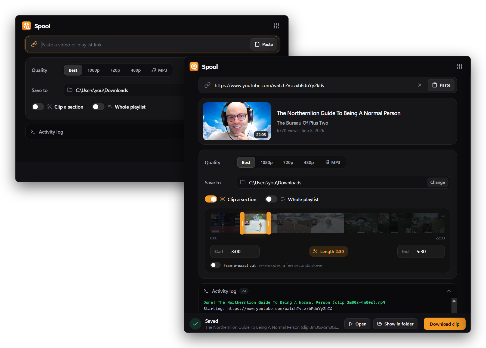

# Spool

A small desktop app for downloading videos, and clips of videos, with
[yt-dlp](https://github.com/yt-dlp/yt-dlp). Paste a link, pick a quality, download.

<p align="center">
  
</p>

- **Preview first:** title, channel, length and thumbnail appear as soon as you paste a link.
- **Clip any section:** drag handles on a timeline that shows real frames from the video, or
  type start/end times. On YouTube, Spool fetches only the part of the stream the clip
  needs, so a 20-second clip from a 3-hour video takes a few seconds rather than a full download.
- **Quality presets:** Best, 1080p, 720p, 480p, or MP3 audio.
- **Copes with YouTube's quirks:** if YouTube refuses a download (HTTP 403), Spool retries
  without cookies, then via HLS, before giving up.
- **Clean cancel:** stops ffmpeg and removes half-written files.

Works on any site yt-dlp supports. Built for Windows.

## Requirements

- Windows 10 or 11 (the window uses Microsoft Edge WebView2, which Windows 11 includes)
- Python 3.10+
- [ffmpeg](https://ffmpeg.org/download.html) on your `PATH`, for merging audio/video, clipping and MP3
- [Node.js](https://nodejs.org/) on your `PATH`, which yt-dlp uses to solve YouTube's JavaScript challenges

## Setup

```
pip install -r requirements.txt
python main.py
```

To launch it like a normal app, make a shortcut that runs
`pythonw.exe "C:\path\to\spool\main.py"` (`pythonw` avoids a console window) and set its
icon to `icon.ico`.

## Cookies

Off by default: YouTube now tends to *refuse* downloads from logged-in sessions. You only
need cookies for age-restricted or members-only videos. Turn them on under Settings (the
sliders icon), either straight from your browser or from an exported `cookies.txt`.
`cookies.txt` is in `.gitignore`. It holds live login tokens, so never commit it.

## When it breaks

Sites change constantly, and yt-dlp keeps up. If downloads start failing after a while
away, update it first:

```
pip install -U "yt-dlp[default]"
```

`python diagnose.py <url>` reports how a link's streams are served and whether they can be
clipped quickly. Add `--seek-test` to time a real seek.

## Project layout

| File | What it does |
|---|---|
| `main.py` | Opens the window and bridges the page to Python |
| `ui/` | The interface: `index.html`, `style.css`, `app.js` |
| `engine.py` | Downloading: retries, progress, cancel |
| `clipper.py` | Fast clipping: reads the stream's index and fetches only the needed byte ranges |
| `diagnose.py` | Troubleshooting tool for a single link |
| `make_icon.py` | Regenerates `icon.ico` |

## Please be considerate

Only download what you have the right to. Respect creators and the terms of the sites you use.

## License

MIT. See [LICENSE](LICENSE).
